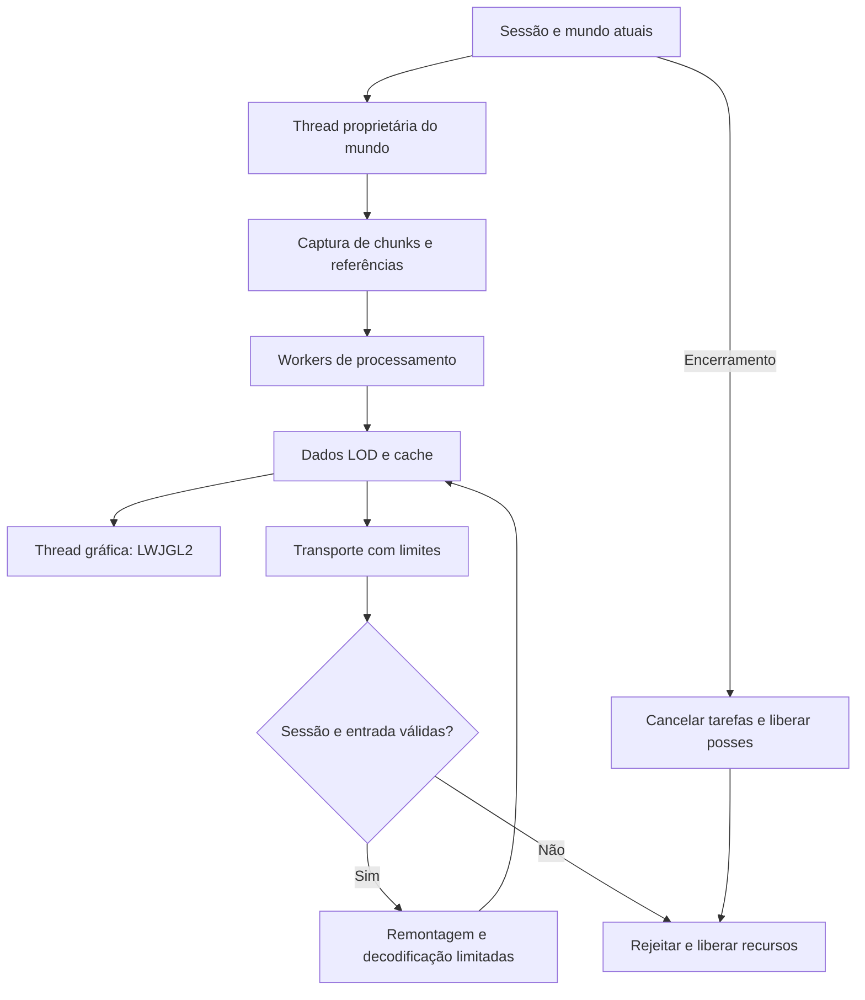
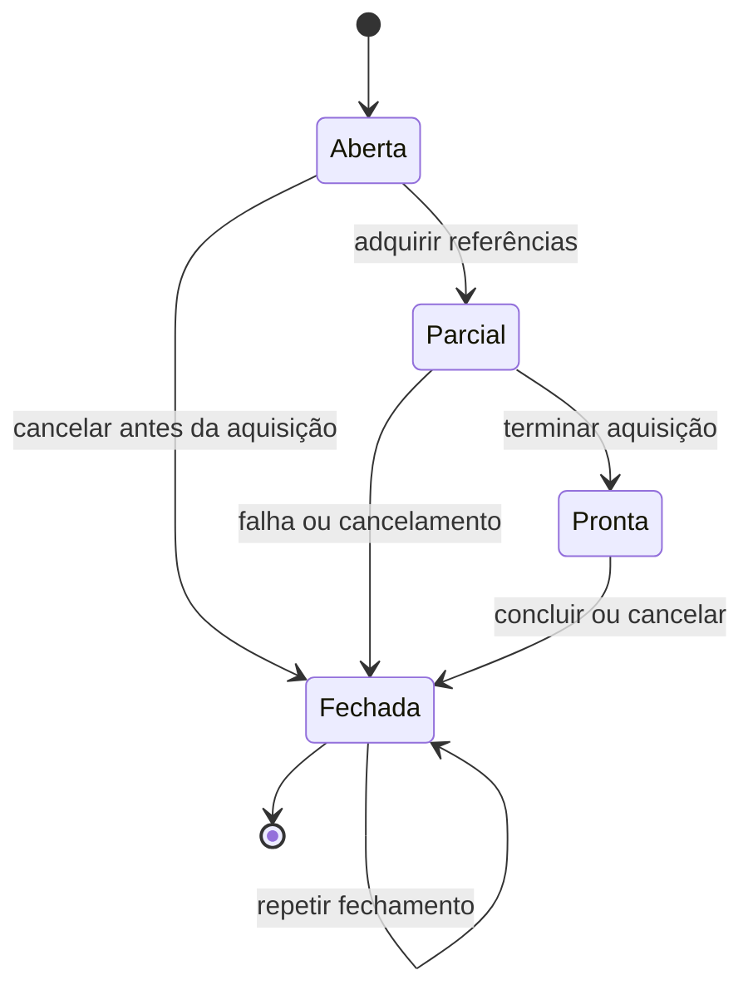
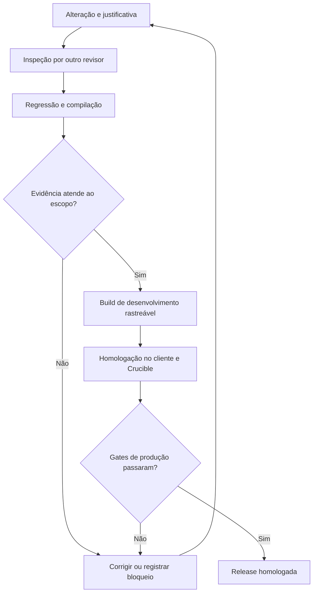

# Akashic: Horizons of The Mirai

## Contrato do projeto

O Mirai é um fork de estabilização do Distant Horizons para Minecraft 1.7.10. A proposta é desenhar terreno distante simplificado com LWJGL2, aproveitar a estrutura existente e adaptar a integração ao Forbidden Series. O servidor de referência operacional do usuário é Crucible com Java 21. A primeira linha de desenvolvimento é `0.1.0-dev`; o nome não representa uma homologação de produção.

O ponto de partida é o commit principal `b4abe2f26bd1da4ce86ba5323711b2b50de84930`, com o core `791070ae3647c1791b057f6269431434369da128`, da branch `merge-1.7.10`. O core já se identifica como DH `3.2.1-b-dev`, API `7.1.0`. Não se iniciou um segundo backport nem se substituiu o formato de dados, o banco de cache ou o renderizador por implementações novas.

O objetivo de estabilidade se traduz em critérios verificáveis: propriedade de recursos, limites de entrada, tarefas associadas à sessão correta, compatibilidade de lados, recuperação de falhas e evidências de execução. Uma compilação bem-sucedida atende somente parte desses critérios.

## Responsabilidades e distribuição

| Parte | Responsabilidade | Instalação pretendida |
|---|---|---|
| Core compartilhado | Dados LOD, compressão, persistência, filas e protocolo lógico | Incluído no mod |
| Camada comum | Bindings, ciclo de vida, wrappers e gerador interno existente | Incluída no mod |
| Adaptador Forge 1.7.10 | Eventos, canais, chunks, metadata e adaptadores opcionais | Mesmo JAR Forge |
| Backend LWJGL2 | Recursos e chamadas OpenGL no cliente | Ativo somente no cliente |
| Crucible | Mundo, ticks, plugins Bukkit e pipeline híbrido de chunks | Servidor separado |
| Companion Bukkit | Eventual diagnóstico/política administrativa | Não implementado nem exigido nesta etapa |

O cliente precisa do mod para renderizar LODs. Um plugin exclusivamente Bukkit não pode acrescentar esse renderizador ao cliente. O componente dedicado pode fornecer dados distantes quando houver instalação e compatibilidade nos dois lados. O cliente sem fonte desses dados só pode representar regiões que recebeu ou que já tem no cache compatível.

O verificador Forge desta linha permite que um cliente Mirai entre em servidor sem o mod. Instalar o Mirai no servidor, porém, exige clientes com o mod e versão correspondente. A instalação no dedicado precisa considerar esse requisito antes de atender jogadores do pack.

Não se deve instalar este fork junto com outro Distant Horizons. O identificador `distanthorizons`, os namespaces e o arquivo `DistantHorizons.toml` foram preservados para reduzir quebras de integração; a identidade pública, a versão e os créditos distinguem o Mirai. Configurações e caches existentes devem ser copiados para homologação, pois manter nomes não prova compatibilidade de todos os dados antigos.

## Fluxo dos dados

O diagrama descreve responsabilidades, não autoriza workers a modificar objetos `World` nem transfere operações OpenGL para executores arbitrários. O servidor produz dados; a GPU do cliente os desenha. Acesso ao disco, compressão e processamento podem ocorrer fora da thread do mundo quando os objetos usados têm propriedade e estabilidade definidas.

O limite de uma etapa deve considerar bytes e trabalho pendente. Limitar apenas a quantidade de mensagens é insuficiente quando uma mensagem pode declarar um array enorme. Um consumidor lento precisa impedir que produtores acumulem indefinidamente tarefas e buffers.

## Inicialização e capacidades

No caminho Forge 1.7.10, accessors são registrados antes de os wrappers do DH capturarem referências estáticas. O registro é idempotente, usa o loader Forge diretamente nessa fase precoce e separa o cliente físico do lado lógico de uma thread. Um único objeto é associado aos aliases de cada integração.

Hodgepodge possui três situações de diagnóstico: ausente; instalado com a configuração de supressão desativada; instalado com a configuração habilitada. O Mirai não liga automaticamente `addSimulationDistance_WIP`. Mesmo a terceira situação não certifica supressão de simulação no Crucible ou perto de jogadores.

A construção vanilla de `EntityRenderer` antecede a inicialização dos mods. Por isso, o accessor RPLE nesse mixin é consultado no uso, em vez de ser capturado permanentemente como `null` na carga da classe. Essa consulta localizada é uma consequência do ciclo de vida real, não uma conversão indiscriminada de todos os accessors para buscas por frame.

## Propriedade de chunks

Cada solicitação de geração precisa liberar exclusivamente aquilo que adquiriu. Os nove chunks de uma vizinhança desejada não são prova de nove aquisições bem-sucedidas. O gerador existente passa a registrar as referências efetivamente incrementadas em uma posse por solicitação.

Os testes devem cobrir aquisição parcial, vizinhanças sobrepostas, encerramento antecipado, fechamento duplicado e exceções em callbacks. A referência do chunk, a marcação de ignorar processamento e a supressão de simulação são efeitos diferentes: uma liberação de supressão exige uma aquisição correspondente. O descarregamento físico é outra operação; um plugin pode cancelá-lo sem que isso constitua vazamento de um ticket pertencente ao Mirai.

A transição para fechada impede aquisições tardias na mesma posse. Repetir fechamento não pode descontar a referência de outro trabalho que reutilizou a mesma coordenada.

## Crucible e geração distante

A revisão do Crucible público foi fixada em `47a2c67f842b136309f8a336808fd34146887cdb`, branch `staging`. Esse commit é referência de análise, não identificação do JAR instalado pelo usuário.

O Crucible separa leitura de disco assíncrona de integração síncrona do chunk; mantém mapas e eventos híbridos; permite cancelamento Bukkit de unload; usa uma fila principal drenada no tick; e acrescenta atividade de chunks persistentes a caminhos de simulação. Essas diferenças exigem testes próprios de mundo, tickets, entidades, tile entities, crescimento e ticks agendados. Sucesso em Forge puro não basta.

O padrão novo de `enableDistantGeneration` é falso. No dedicado 1.7.10 desta build, há também restrição efetiva de inicialização: a geração permanece desativada até existir a propriedade JVM `-Dakashic.mirai.experimentalServerGeneration=true`. Essa propriedade somente remove a restrição experimental; a configuração de geração ainda precisa estar ativada. A seleção do gerador suportado `INTERNAL_SERVER` também é aplicada no dedicado.

O servidor integrado respeita sua configuração. Portanto, uma configuração antiga com geração ativada exige revisão antes do primeiro teste. O desenvolvimento dos recursos continua; a política conservadora não transforma a geração híbrida em um recurso homologado.

## Renderização e recursos nativos

O backend permanece LWJGL2. A versão da biblioteca de acesso não define sozinha as capacidades do contexto OpenGL. O diagnóstico e a homologação precisam observar GPU, driver, contexto, GLSL, shaders e estado efetivo do renderizador.

O upload seguro de shaders conserva o mecanismo existente e libera o buffer UTF-8 em `finally`. Isso corrige a propriedade do buffer retornado pelo alocador; não é uma medição de RAM nem prova de compatibilidade com todos os drivers AMD ou Intel.

O redirect de fog volta a publicar o evento Forge exatamente uma vez, preserva o retorno de cancelamento e mantém a intervenção do Mirai no passe de terreno. Um teste do corpo Java não prova que o mixin tenha encontrado a chamada correta em todas as combinações de coremods. Essa correspondência permanece um gate de execução.

## Perfis de hardware

| Cenário | Ponto de partida para homologação | Evidência necessária antes de ampliar |
|---|---|---|
| CPU limitada e GPU integrada | Raio 32–64, shaders desligados, perfil de threads mínimo ou customizado | Latência de frame, filas, memória nativa e tempo do servidor |
| Configuração nova do Mirai | Raio 64, até 2 workers configurados, razão de atividade 0,5 | Conferir valores efetivos após listeners e carregamento de configuração |
| Máquina equilibrada | Experimentar 64–128 mantendo limites | Comparar percurso e cache iguais |
| Máquina potente | Aumentar distância e qualidade gradualmente | Ausência de crescimento acumulativo e pausas recorrentes |
| Contexto gráfico insuficiente | Não iniciar um caminho indispensável incompatível | Mensagem diagnóstica e capacidade real do backend |

São parâmetros de partida, não resultados medidos nem promessa de FPS. O número de workers configurados não equivale ao total de threads do processo: rede, renderização e serviços do Minecraft têm outros executores. Arquivos de configuração existentes preservam seus próprios valores; a mudança de defaults não os sobrescreve.

## Inspeção, auditoria e aprovação

Foram delegados papéis de implementação da integração, engenharia de build, auditoria do Crucible, revisão do core e endurecimento do transporte. As alterações de posse do gerador e de renderização receberam leitura cruzada. Uma revisão detectou uma falha na primeira versão do próprio patch de posse, demonstrando por que autoria e aprovação não devem ser confundidas.

Os revisores são agentes desta sessão, não uma certificadora independente. A avaliação final precisa indicar quais testes usaram dependências reais, quais usaram doubles e quais não foram executados. A decisão de produção permanece distinta da decisão de distribuir uma build para teste.

## Critérios da futura release estável

1. Inventário por SHA-256 dos JARs reais, configurações, shaders, bootstrap, Java e Crucible.
2. Inicialização cliente/integrado/dedicado sem carregar classes do lado incorreto; aplicação dos mixins críticos comprovada.
3. Rede rejeitando truncamento, tamanhos absurdos, IDs/lados inválidos, excesso de filas e resultados de sessões antigas; buffers liberados após erro e desconexão.
4. Geração com aquisição parcial, cancelamento, exceção, unload cancelado e parada, sem consumir referências ou supressões de outros trabalhos/mods.
5. Cache recuperável em cópia de teste após encerramento abrupto e sem mistura de mundo/dimensão.
6. Angelica e shaders avaliados nas versões e configurações reais, incluindo recarga de recursos, menus e troca de dimensão.
7. Sessão prolongada com memória e filas estabilizadas e percentis de latência aceitáveis em hardware modesto e potente.
8. Fonte correspondente, versão, hashes, dependências e instruções de retorno disponíveis junto com o binário.

## Fontes principais

- [Distant Horizons: commit-base](https://gitlab.com/distant-horizons-team/distant-horizons/-/tree/b4abe2f26bd1da4ce86ba5323711b2b50de84930)
- [Core: commit-base](https://gitlab.com/jeseibel/distant-horizons-core/-/tree/791070ae3647c1791b057f6269431434369da128)
- [Crucible: build e bibliotecas](https://github.com/CrucibleMC/Crucible/blob/47a2c67f842b136309f8a336808fd34146887cdb/build.gradle.kts)
- [Crucible: chunks e eventos](https://github.com/CrucibleMC/Crucible/blob/47a2c67f842b136309f8a336808fd34146887cdb/patches/net/minecraft/world/gen/ChunkProviderServer.java.patch)
- [Crucible: atividade e simulação](https://github.com/CrucibleMC/Crucible/blob/47a2c67f842b136309f8a336808fd34146887cdb/patches/net/minecraft/world/World.java.patch)
- [FML: ordem de inicialização do cliente](https://github.com/MinecraftForge/FML/blob/1.7.10/patches/minecraft/net/minecraft/client/Minecraft.java.patch)

Os fontes locais fixados e seus diffs são a evidência da implementação. O inventário derivado do log do usuário está em `inventory-log-20260905.json`; campos SHA-256 nulos significam bytes não verificados, e não hash desconhecido substituído por suposição.
