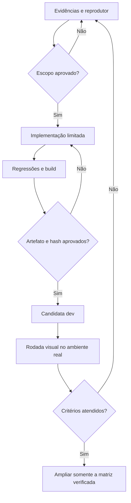

# Homologação planejada — Akashic: Horizons of The Mirai 0.1.4-dev

Este documento define escopo, responsabilidades e critérios de aceitação da candidata para Minecraft 1.7.10. É um plano verificável; não substitui os resultados e o parecer do artefato final. A designação máxima permitida antes de executar o jogo no ambiente do usuário é **candidata de homologação**.

O parecer `APPROVAL-SCOPE.md`, no dossiê desta rodada, autorizou implementar R-01, R-02, R-03, G-01 e S-04. O adendo `APPROVAL-SCOPE-S05.md` aprovou S-05 como condição adicional da candidata: associação de dados e hashes por lote, confirmação real de escrita e recuperação seletiva do índice derivado. Essas autorizações não antecipam aprovação do JAR. Build, testes, commits raiz/core, shaders empacotados e SHA-256 devem constar do relatório final da entrega.

## Evidências e o que elas permitem concluir

| Evidência recebida | O que sustenta | Limite que permanece |
|---|---|---|
| Vídeo de aproximadamente 70 segundos e quatro screenshots | Terreno próximo, faixas distantes, regiões brancas e faces expostas; vanilla 32 e raio LOD 64 visíveis na interface | Não identifica sozinho a causa de cada pixel branco nem fornece benchmark controlado |
| `latest.zip`, contendo apenas `latest.log` | Build 0.1.3-dev carregada, Intel UHD, LWJGL2, Angelica presente com shaderpacks desligados, funcionamento após segunda entrada | Não contém JARs do modpack ou as configurações completas |
| `options(1).txt` | Configuração salva: vanilla 32, VSync, limite 60 FPS, FBO, mipmaps 4 e resource pack selecionado | Não registra cada mudança de configuração durante a gravação |
| Dois logs do Crucible | Java 21, Mirai no servidor, geração distante dedicada desativada, reconexão prolongada e conflitos de dimensões | São duas saídas da mesma execução; não contam como dois testes independentes |
| `Distant_Horizons_server_data.rar` | Dois SQLite examinados, 164 registros V2 decodificáveis, cobertura parcial e 21 coordenadas em `ChunkHash` sem coluna de detalhe zero correspondente na cópia | O RAR não contém WAL/SHM; a cópia não garante a última escrita da execução e não identifica a causa individual das 21 ausências |
| Reprodutores de armazenamento contra a implementação anterior | Checksum obsoleto após mutação e, separadamente, sete condições de associação incorreta de lote ou confirmação falsa de escrita reproduzidas em Java 8 e 21 | O reprodutor S-05 usa JDBC/executor controlados; não certifica transações SQLite reais nem prova que cada mecanismo causou uma coordenada órfã anexada |
| Código e JAR da 0.1.3-dev | Mecanismos reproduzíveis de composição, recorte por distância configurada e metadado obsoleto | A inspeção não certifica comportamento de toda combinação de drivers, mods ou shaders |

A rastreabilidade detalhada está em `logs/RELATORIO-LOGS.md`, `visual/OBSERVATIONS.json`, `rendering/AUDITORIA-COMPOSICAO.md`, `geometry/READONLY-FINDINGS.md` e `storage/AUDITORIA-CACHE.md` e `storage/s05-review/RESULTS.json`, no dossiê de evidências da rodada. Os horários de quadros exatos estão no manifesto visual. Não aplicar uma diferença fixa aos relógios do cliente e do servidor sem demonstrar a sincronização.

O CastleOfStone expulsou o primeiro login, foi recarregado e a segunda conexão permaneceu de 15:18:56 a 18:07:40 no relógio do servidor. A rodada filmada não estava bloqueada por essa expulsão. Parte das 2 h 48 min 44 s conectadas ocorreu em AFK; não é um teste equivalente de movimento e carga contínuos.

## Arquitetura mantida e contratos

A candidata conserva o core compartilhado, a adaptação Forge 1.7.10 e o backend LWJGL2. Não cria outro gerador, banco ou framework de tarefas. Cada alteração permanece na camada proprietária do problema.

| Camada | Responsabilidade nesta candidata | Invariante |
|---|---|---|
| `LodRenderer` e compositor OpenGL | Decidir a composição conforme atividade do shaderpack; ordenar composição, AA opcional e aplicação final | Nenhuma aplicação de textura sem composição válida após falha |
| Recurso GLSL de fade | Misturar horizonte e preservar a imagem original quando o LOD tem alfa zero | `smoothstep` com limites crescentes; retorno antes de operações inválidas no caso vazio |
| Wrapper Minecraft 1.7.10 | Medir cobertura contígua recebida para limitar a transição vanilla/LOD | Lookup local sem carregar/gerar chunks, sem reter mundos ou chunks fortemente |
| DTO de dados V2 | Calcular checksum atual no limite de serialização sob propriedade exclusiva | Preservar formato, algoritmo e dados existentes; nenhuma migração destrutiva |
| Snapshot e persistência por lote | Associar hashes aos dados do mesmo lote, reconhecer a escrita e só então atualizar o índice | Conclusão de A não confirma nem remove B; falha não publica sucesso; recuperação seletiva sem decodificação no render |
| Ciclo de vida e diagnóstico | Restaurar estado, fechar recursos pertencentes e tornar falhas rastreáveis | Preservar a causa principal e suas supressões; limitar frequência de mensagens |

A thread cliente proprietária consulta o provedor real de chunks e executa operações de GPU no contexto apropriado. Workers continuam sujeitos aos contratos existentes de propriedade de dados. “Assíncrono” não autoriza acesso arbitrário a objetos mutáveis do mundo.

## Papéis e separação dos passes

| Papel | Responsável nesta rodada | Entrega exigida |
|---|---|---|
| Arquiteto e integrador | Agente coordenador | Fixar escopo, integrar mudanças, identificar os commits e produzir a candidata |
| Inspetor de logs e ambiente | Passe `audit_session_logs` | Cronologia, configurações comprovadas, problemas externos e limites da evidência |
| Inspetor de composição | Passe `audit_sky_composition` | R-01/R-02/R-03, propriedade de recursos e regressões de falha |
| Inspetor de cobertura | Passe `audit_geometry_handoff` | G-01, limite de consultas, invalidação e comportamento numérico |
| Auditor de armazenamento | Passe `audit_lod_storage` | S-04/S-05, decodificação do cache, propriedade dos lotes, confirmação SQL e recuperação seletiva |
| Verificador gráfico adicional | Passe `prepare_offscreen_gl` | Quando viável, executar o GLSL real fora da tela e identificar driver/contexto |
| Aprovador | Passe `approval_review`, separado da implementação revisada | Autorizar o escopo e depois revisar commits, resultados e JAR exatos |
| Homologador do ambiente real | Operador na máquina cliente e no Crucible de teste | Repetir o percurso visual e devolver os logs da mesma execução |

São passes de agentes sobre uma tarefa compartilhada, não certificação externa. O aprovador pode devolver uma alteração mesmo que compile. Nenhum papel pode transformar ausência de mensagem de erro em prova de ausência de defeito.

## Fluxo de aprovação

## Escopo de implementação e portões

O progresso abaixo distingue autorização de resultado: os seis itens, incluindo o adendo S-05, foram aprovados **para implementação**. O aceite de cada implementação deve ser preenchido pelo relatório final, depois dos testes; este plano não apresenta esses resultados como já executados.

| ID | Mudança autorizada | Resultado mínimo exigido |
|---|---|---|
| R-01 | Distinguir Angelica presente de shaderpack ativo | Atividade consultada uma vez no passe; composição coerente, AA ordenado, caminho de pack ativo preservado, evento apply uma vez e cancelamento respeitado |
| R-02 | Corrigir fade com limites invertidos e alfa zero | Início/meio/fim corretos; alfa DH zero devolve cor Minecraft com alfa final 1 antes de divisão ou reconstrução inválida; recurso final inspecionado no JAR |
| R-03 | Interromper composição/aplicação após falha | Viewport positivo, texturas e destino válidos, framebuffer intermediário completo; falha bloqueia apply, cleanup tenta todos os recursos e preserva causas |
| G-01 | Limitar transição à cobertura recebida no 1.7.10 | Quadrado contíguo real, no máximo 4.225 consultas por amostra, cache por tick/chave, ausência de carga/geração/retenção; casos de buraco e cobertura menor que slider |
| S-04 | Recalcular checksum atual ao formar DTO | Mutação depois do hash em cache gera metadado coerente com o DTO decodificado; preservar algoritmo/formato, sem rejeitar ou reescrever bancos antigos |
| S-05 | Associar snapshot/hash por lote, exigir confirmação de escrita e recuperar índice derivado inconsistente | Conclusões permutadas não confirmam lotes novos; falha SQL/shutdown/rejeição não confirma hash ou evento; cobertura ausente invalida o fast path com verificação limitada fora do render |

### Renderização e falhas

Executar a classe real `LodRenderer` com doubles identificados e controles negativos contra a 0.1.3. Verificar ordem composição → AA opcional → apply, uma postagem do evento, cancelamento e transparência adiada sem duplicidade. Testar falha de setup, shader, alocação, composição e framebuffer incompleto.

`GL_FRAMEBUFFER_COMPLETE` deve ser conferido depois de criar e anexar o framebuffer intermediário. OpenGL pode sinalizar um estado inválido sem exceção Java. Falha deve impedir cópia de textura incompleta ou antiga e encerrar o escopo de estado. Erro de restauração não deve apagar a causa anterior. O mecanismo existente do `ClientApi` para `Exception` não é promessa de recuperação de qualquer `Error` da JVM.

Não introduzir `glGetError` em cada frame, reset indiscriminado de contexto ou destruição de singletons de GPU no unload de todo mundo como remendo. Se houver ensaio do GLSL real em Mesa/llvmpipe, registrar explicitamente esse contexto: ele não homologa Intel Windows.

### Cobertura e transição

A matriz inclui configuração 32/cobertura 9, buraco interior, borda ausente, corredor, chunks isolados, coordenadas negativas e limites inteiros, opções zero/negativas/excessivas, câmera ou mundo ausente, provedor inesperado e troca de mundo/câmera.

No `ChunkProviderClient` inspecionado, `chunkExists` retorna sempre true; não serve como prova de presença. O caminho autorizado consulta apenas o provedor cliente conhecido, rejeita `EmptyChunk` e aceita chunk real de ar, importante para lobby void. Provedor inesperado recebe tratamento conservador; nunca é chamado como gerador arbitrário.

A amostra é reutilizada no mesmo tick e chave. Mudança de mundo/câmera/configuração pode invalidá-la no mesmo tick; não chamar isso de uma única amostra global por tick. Redução da cobertura deve aparecer até a amostra seguinte. Quantificar recorte e dithering para 16:9, 4:3, retrato e prevenção manual de sobreposição em 1,0.

**Limites mantidos:** chunk recebido não prova malha vanilla pronta; margem de dois chunks não demonstra ausência de lacunas em todas as proporções de janela; nenhuma correção de recorte cria LOD para coluna ausente no cache. Voo rápido, viewport retrato e overdraw manual extremo continuam casos explícitos de homologação.

### Persistência

O checksum examinado é um inteiro de 32 bits que exclui o mapping. É metadado de dados, não autenticação nem verificação criptográfica. A divergência reproduzida não autoriza apagar caches, rejeitar bancos existentes ou declarar corrupção.

A revisão S-04 deve demonstrar propriedade/exclusão entre escrever os blobs e calcular o checksum. No caminho inspecionado, `FullDataUpdaterV2.updateDataSource` detém lock por posição, atualiza um destinatário local recém-lido, calcula iluminação e cria DTO. Esse contrato sustenta a propriedade local do conteúdo, mas não sincroniza automaticamente mutações externas dos arrays públicos. Ele também não prova confirmação de SQL: esse segundo contrato foi ampliado pelo adendo S-05.

**S-05 — observação e reprodutor separados.** Foram encontradas 21 coordenadas de `ChunkHash` sem coluna de detalhe zero correspondente no arquivo principal SQLite anexado. O modo WAL e a ausência dos arquivos WAL/SHM impedem certificar que essa cópia inclua as últimas escritas. A contagem é evidência da cópia recebida; não identifica a causa individual de cada lacuna.

Independentemente da cópia, os corpos reais da implementação anterior reproduziram sete condições por JVM em Java 8 e 21: confirmar B ainda não salvo; remover seu hash pendente; confirmar A2 novo ao concluir snapshot A antigo; e completar como sucesso sem escrita por shutdown, executor ausente, rejeição ou exceção capturada. O reprodutor usa dependências controladas declaradas. São resultados da investigação do defeito, não resultados de aprovação da correção, e não substituem teste com SQLite real.

A correção deve associar conteúdo e hashes ao mesmo lote sob a exclusão usada para merge/removal. Depois de removido da fila, seu conteúdo e metadados permanecem próprios daquele ciclo de save. A conclusão de A não consulta um mapa global mais novo para confirmar B, nem instala índice incompatível quando lotes da mesma seção terminam fora de ordem. Revisar coalescência, A1/A2 na mesma coordenada e ordenação da gravação efetiva.

O futuro só pode completar normalmente depois da escrita reconhecida. Shutdown, executor ausente/rejeitado, DTO/provedor indisponível, falha de merge, encoding, SQL ou commit não reconhecido devem terminar excepcionalmente ou cancelados. Corrigir somente o catch assíncrono é insuficiente se o caminho síncrono ainda absorver erro de `repo.save`. Preservar os contratos de `saveChecked`, auto-commit e rollback; exigir ensaios JDBC/SQLite reais no gate de resultado.

O índice de hash deve ser salvo **depois** dos dados reconhecidos. Falhar entre as duas operações pode causar reprocessamento seguro; nunca pode confirmar conteúdo não salvo. Eventos de persistência não devem anunciar sucesso falso. Se um listener falha após commit real, separar falha de observação da confirmação dos dados, evitando retries que repitam efeitos sem necessidade.

Datasource e lote permanecem pertencentes à operação até seu futuro terminal; fechar uma vez, inclusive em rejeição, falha síncrona e shutdown, sem liberar arrays ainda usados por worker aceito. Nenhum futuro abandonado, espera bloqueante no mundo/render, thread sem dono ou retry ilimitado. Revisar chamadores de geração, recebimento remoto e atualizações em tempo real, preservando a API necessária e o protocolo.

**Recuperação seletiva exigida.** Corrigir escritas futuras não resolve sozinho um índice órfão que continua fazendo o fast path ignorar hash igual. O gate exige conferir pontualmente a cobertura antes de aceitar esse caminho, ou reparar seletivamente índice derivado comprovadamente inconsistente, com custo limitado e sem decodificar banco na thread render. Hash igual com cobertura completa conserva a otimização; dados ausentes devem permitir reprocessamento, distinguindo ausência de coluna de chunk real de ar/void. O implementador confirmou como estratégia planejada conferir a seção persistida e as 256 colunas do chunk em worker já existente: se ausente, incompleta ou ilegível, o fast path não deve pular a reconstrução quando o chunk for recebido/revisitado. Registrar o custo de leitura/decodificação de uma seção e o reuso de cache fora do render. Essa estratégia ainda depende dos gates de implementação e do parecer final; não promete varredura global nem recuperação instantânea de regiões não recebidas e não depende de worldgen dedicado. FullData, caches válidos e saves devem ser preservados.

## Cronograma por dependências

Os períodos abaixo são **janelas planejadas de teste**, não promessa de prazo de desenvolvimento nem testes já realizados. Uma falha retorna ao gate responsável; não se avança apenas porque o tempo acabou.

| Fase | Trabalho | Saída e condição de avanço |
|---|---|---|
| A — inventário e reprodução | Mapear anexos, build anterior, contextos cliente/servidor e defeitos demonstrados | Evidência suficiente e escopo autorizado pelo aprovador |
| B — implementação | Aplicar somente R-01/R-02/R-03/G-01/S-04/S-05 e diagnósticos necessários | Diff limitado, contratos de falha e propriedade revisados |
| C — verificação automatizada | Controles negativos, regressões novas, SQL/rollback real, gates anteriores relevantes, Java 8/21 e build Forge 1.7.10 | Resultado real anexado; fontes, bytecode, ABI, remapeamento e shaders correspondentes ao JAR |
| D — aprovação do artefato | Revisar commits raiz/core, hash do JAR, evidências e limitações | Autorizar candidata dev ou devolver o gate que falhou |
| E — primeiro ensaio real, **10 min planejados** | Mesmo Overworld e percurso do vídeo; shaderpacks desligados; cenário original vanilla 32/LOD 64 e controle vanilla 8 | Comparação do céu e das regiões com LOD conhecido, sem travamento ou textura antiga aplicada |
| F — transições reais, **20 min planejados** | Proxy → Paper → Crucible → Paper; reconexão, mudança de câmera/janela e revisita ao local | Identidade de mundo/cache correta, renderização retomada, ausência de resultado de sessão anterior; recuperação seletiva observada conforme estratégia aprovada |
| G — sessão real, **60 min planejados** | Movimento contínuo e pausas identificadas; cache já visitado e área nova separados | Logs correlacionados e consumo/latência observados sem degradação atribuível à candidata |
| H — ampliação controlada | Apenas depois dos gates anteriores: pack Default como comparação, outras resoluções e dimensões sem conflito | Acrescentar somente as combinações de fato aprovadas à matriz |

As janelas 10/20/60 min não constituem teste prolongado suficiente para toda situação. Registrar condições, percurso, estado inicial de cache e momentos de mudança; FPS médio isolado não aprova estabilidade. Quando disponíveis, usar frame time, pausas, memória heap/nativa e telemetria de filas/recursos, distinguindo medição de inferência.

## Bloqueios para homologação ampla

- O modpack integral, o resource pack selecionado e as configurações completas não estão neste conjunto de anexos. O nome de uma dependência no log não substitui seu JAR e hash.
- Os IDs de dimensão **-19, -37, -34, -38, -31, -39 e -42** falham no registro dos dois lados. Não homologar essas dimensões nem alterar seus IDs automaticamente em saves existentes.
- `ForceGlass`, os minérios AE2 sem ícone utilizável, 196 texturas ausentes e shaders próprios do MatterOverdrive com falha exigem reprodutores independentes. Não atribuir tudo ao driver ou ao Mirai por coincidência temporal.
- Manter geração distante dedicada experimental desativada e Hodgepodge WIP sem autoativação. Esta correção visual não aprova geração no híbrido.
- A máquina observada usa Java 8u51 no cliente e Java 21 no servidor. Build com bytecode Java 8 e ensaios Linux não certificam automaticamente aquele runtime Windows ou o driver Intel.
- Não há promessa de ausência absoluta de bugs, exploits ou defeitos de driver. Todo resultado deve indicar cenário, versão e limite; achado demonstrado fora do escopo permanece registrado para uma etapa própria.

## Evidência mínima da rodada real

Registrar nome e SHA-256 do JAR, versões cliente/servidor, screenshot das opções, resolução, shaderpack e resource pack ativos. Anexar `latest.log` completo da execução, logs correspondentes do Crucible e vídeo com os momentos marcados. Comparar a mesma região antes/depois, separando céu branco, recorte artificial, malha ainda carregando e ausência legítima de LOD armazenado.

O relatório final deve informar para cada gate: **aprovado, reprovado ou não executado**, com ligação para a evidência correspondente. A publicação de uma candidata não muda automaticamente um resultado “não executado” para “aprovado”.
