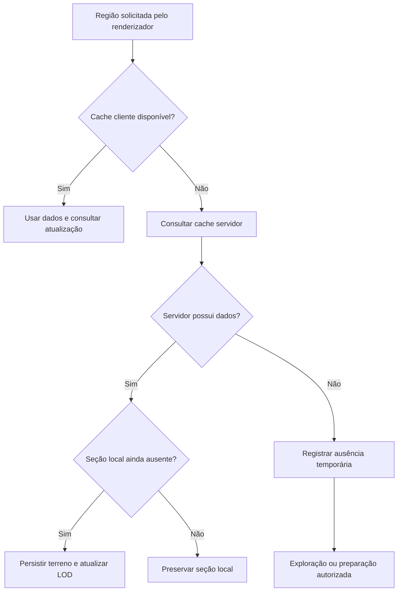

# Homologação — 0.1.5-dev

## Objetivo e responsabilidades

Preservar a arquitetura de LOD do DH enquanto se corrige o acesso inicial a dados remotos, a propriedade de tarefas entre mundos e o trabalho temporário na renderização. Autores separados examinaram rede, culling, dimensões e preparação administrativa; um revisor distinto inspeciona os contratos e o artefato. Os resultados finais e hashes acompanham o JAR.

## Contrato do carregamento

A consulta de cache não gera chunks e não equivale à geração de terreno. Regiões desconhecidas não viram ar confirmado. Sincronização segue limites negociados de distância, fila e banda; não cria polling contínuo de toda a dimensão.

A ausência é verificada dentro da trava de atualização da posição; uma falha de consulta impede a inserção. A entrada inicial não se propaga para seções filhas nem substitui beacons. Isso protege dados capturados durante a transferência, com a limitação de preservar também seções locais parciais. As atualizações normais mantêm sua semântica anterior.

## Portões

| Área | Critério |
|---|---|
| Cache inicial | Solicitação com cache vazio percorre o caminho existente somente de leitura; gerar terreno permanece desativado. |
| Ausência e limites | Resposta vazia não grava LOD fictício; repetição e fila são limitadas; falhas não vazam permissões. |
| Fechamento | Resposta e chunks de um mundo anterior não são publicados em outro; buffers adquiridos são liberados nas fronteiras testadas. |
| Culling | Decisões antigo/novo coincidem com o mesmo JOML; alocações são medidas separadamente de FPS. |
| Preparação | Não chama carga/geração de chunks, respeita a thread dona do mundo e cancela ao sair; status distingue submissão de persistência. |
| Artefato | Build integral, testes core/API, bytecode, identidade interna, referências às dependências e integridade do JAR final. |

## Rodada no ambiente do usuário

| Etapa | Janela sugerida | Critério |
|---|---|---|
| Entrada inicial | 10 min | Cliente de teste vazio recebe dados existentes, parado; gerações experimentais continuam desativadas. |
| Cena fixa | 10 min | Mesma posição/horário/efeitos/opções; comparar continuidade e tempos de frame. |
| Dimensões e proxy | 20 min | Entrar/sair/retornar ao The End e ao backend sem mistura de dados. |
| Exploração | 30–60 min | Movimento e pausas documentados; separar regiões com e sem LODs existentes. |

São janelas de teste propostas, não prazos garantidos para estabilização. Nenhuma validação isolada substitui o modpack real.

## Pendências explícitas

- Conversão de chunks salvos e descarregados: contrato do carregador e biomas de mods ainda impede liberação segura nesta rodada.
- Cortes, dither exposto e horizonte branco: ainda não há reprodução isolada que atribua cada sintoma aos dados ou à composição. Nenhuma correção global de altura/fog foi aplicada.
- Ordenação de transparência: estrutura e percurso dos buffers precisam de revisão conjunta, antes de alterar somente uma ordem.
- `WorldChunkUpdateManager` retém gerenciadores por mundo durante a sessão; uma correção completa exige controlar também tarefas já entregues a workers antes de encerrar o nível. A presente revisão impede encaminhamento por identidade incorreta, sem apresentar isso como solução integral dessa retenção.
- O aviso histórico de bioma `EMPTY` ocorreu antes da conexão final ao backend; não estabelece a causa dos defeitos visuais posteriores.
- Java Windows/driver Intel, Angelica em jogo, shaders e dimensões com conflitos de registro nos logs anteriores não foram homologados localmente.

O critério de entrega é uma candidata rastreável com correções verificadas e limitações explícitas. Aprovação de produção depende da rodada real e da resolução dos bloqueios aplicáveis.
