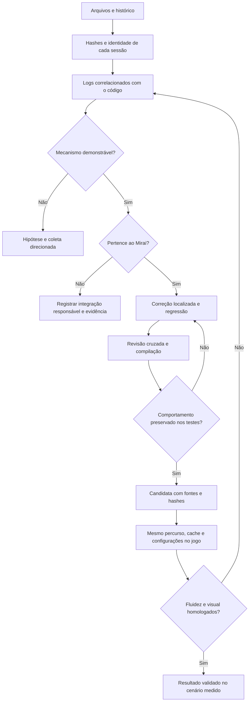

# Plano de engenharia — 0.1.8-dev

Objetivo: corrigir defeitos demonstráveis e reduzir trabalho desnecessário da 0.1.7 no cliente Minecraft 1.7.10/LWJGL2, conservando distância, qualidade, geometria, cores, shaders e configuração do jogador. Fluidez medida em jogo é um critério separado da compilação e dos ensaios isolados.

## Ordem de execução e subobjetivos

1. **Restaurar e identificar.** Conferir hashes externos e os 1.349 arquivos do manifesto interno; registrar a divergência entre ZIP candidato e relatório final. Recuperar histórico disponível sem tratar documentos antigos como novas instruções.
2. **Separar as sessões.** `latest.log` é 0.1.7; `previous-1/2.log` são 0.1.6. Quantificar frames, pausas, uploads, GC e rede sem somar temporizadores inclusivos nem atribuir ao Mirai as pilhas de outros mods.
3. **Corrigir a interpretação de dados vazios.** Ignorar a sentinela zero antes de consultar o mapa de IDs. Preservar blocos válidos de ID zero e avisos de inconsistências reais. Ensaiar com DTO e transformador reais.
4. **Eliminar redundâncias de menor alcance.** Remover criação/destruição de buffer imutável ainda não utilizado; reutilizar vetores de culling de nuvens mantendo a mesma aritmética; tornar pilhas de agendamento uma opção explícita de diagnóstico.
5. **Corrigir o agendamento gráfico.** Coalescer callbacks de manutenção, revalidar se ainda necessários ao executar, respeitar o orçamento normal e conservar as tarefas restantes. Corrigir a média por tarefa que acumulava o tempo de toda a fila.
6. **Confrontar upstream e integrações.** Registrar decisões sobre Voxy/DH e contratos de Angelica 2.2.8, CoreTweaks, ParallelMipMap e EntityCulling, com versões e fontes fixadas. Não importar outra arquitetura de renderização sem prova de benefício e compatibilidade.
7. **Compilar e testar.** Build completa, regressões de comportamento, controles negativos, Java 8/21 e verificação de identidade/bytecode/ABI do artefato. Os ensaios que simulam GL comprovam chamadas e estado do código, não desempenho do driver.
8. **Entregar candidata rastreável.** Fontes correspondentes, JAR, hashes, resultados e pendências. A homologação visual e a medição antes/depois ficam explicitamente abertas se o jogo não foi executado.

## Fluxo de decisão

## Restrições e decisões

- Não modificar a instalação ativa, mundos, cache ou configurações para fabricar uma comparação favorável.
- Não reduzir qualidade como substituto para corrigir desperdício.
- Não trocar LWJGL, Java do launcher, driver, mods externos ou protocolo nesta candidata.
- Uma tarefa gráfica individual pode exceder seu orçamento; Java não pode interromper com segurança uma chamada nativa de upload em andamento.
- Quantificar ganhos estruturais (operações/alocações evitadas) sem convertê-los em promessas de FPS.
- Manter as conclusões revisáveis: associação temporal de um log não comprova causa exclusiva.
