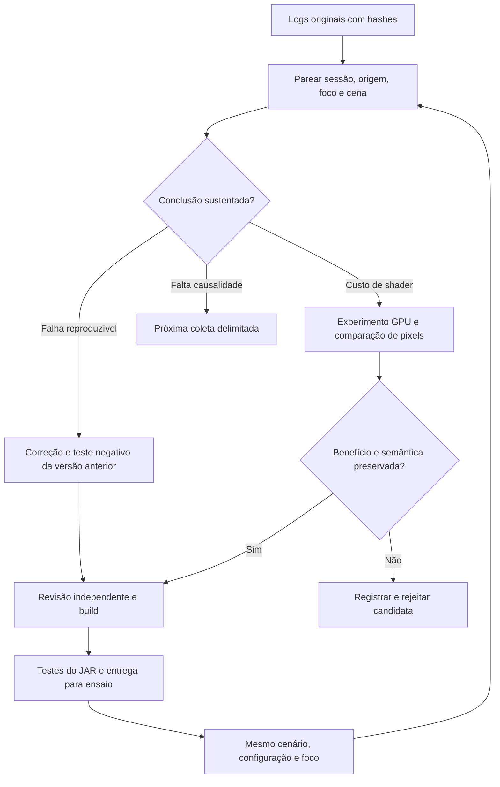

# Plano da candidata 0.1.10

## Decisão de engenharia

A rodada 0.1.9 avançou no diagnóstico, sem demonstrar ganho de FPS. A [auditoria dos arquivos originais](ANALISE-LOGS-0.1.9.md) encontrou uma exceção Mirai real, custo elevado dos intervalos GPU SSAO/AA, pressão episódica no Render_Load e uma transição de aproximadamente seis segundos ainda sem atribuição causal completa.

O relatório recebido foi uma hipótese a verificar. Seus números GPU misturam populações, o máximo observado da fila é maior que 168, e `sync_deferred` positivo coincide com servidor não apto à sincronização. Uma janela sem erros e o encerramento normal não certificam a sessão inteira.

## Metas e ordem de execução

1. Congelar e verificar entradas; associar segmentos da mesma sessão e amostras GPU à origem, separando foco, GUI e transição.
2. Corrigir a ausência transitória de câmera e impedir que o mesmo tick prossiga com uma posição de jogador inválida. Preservar interpolação, terceira pessoa e comportamento normal da rede.
3. Corrigir ownership de geometria e buffers nos caminhos de erro/cancelamento. Trabalho antigo não deve publicar recursos numa seção encerrada; memória só pode voltar ao pool após os consumidores terminarem.
4. Experimentar reduções de custo nos shaders caros em processo OpenGL isolado. Aceitar somente alterações justificadas por semântica, comparação de pixels e medida; documentar candidatas rejeitadas.
5. Compilar o artefato final, testar Java 8/21 e verificar identidade/compatibilidade do JAR distribuído. Entregar fontes, evidências e hashes.
6. Validar no modpack com cenas comparáveis; somente essa etapa pode confirmar FPS e aparência no jogo após a atualização.

## O que as evidências não autorizam

- Desligar SSAO, AA, fog, transparência ou reduzir raio/resolução automaticamente. Isso muda o ambiente visual e não atende ao requisito desta rodada.
- Aumentar threads por comparação bruta de tamanhos de filas. Render_Load e LOD_Builder executam trabalhos distintos; a fila do segundo não representa toda construção de geometria.
- Reutilizar cache com base somente em endereço, dimensão, token transitório ou contador de handshake do Patcher. O protocolo DH já oferece chaves de servidor/level; quando elas não chegam, o cache isolado continua necessário. Uma identidade permanente precisa vir de uma fonte capaz de distinguir mundo e geração de dados.
- Declarar que o stall de 6,098 s foi causado pelo cache ou completamente resolvido. Houve troca de mundo, mas faltam pilhas contemporâneas e fronteiras de lifecycle que atribuam todo o intervalo.
- Habilitar automaticamente `addSimulationDistance_WIP` do Hodgepodge. O ensaio multiplayer mostrado não demonstra que geração distante local seja a causa do FPS.
- Portar o renderer moderno do Voxy por semelhança conceitual. A compatibilidade OpenGL/LWJGL2/Angelica e as condições de licença continuam exigindo avaliação independente. Não foi importado código do Voxy nesta candidata; a comparação anterior permanece em [VOXY-DH-0.1.8.md](VOXY-DH-0.1.8.md).

## Próxima coleta: curta, com duas perguntas diferentes

Para custo estável de render, manter a mesma instalação/configuração, resolução, posição e direção de câmera. Após os LODs carregarem, usar `/miraidiag mark steady_start` e `/miraidiag gpu 60`, fechar o chat e manter o jogo em foco durante a captura. Repetir na mesma cena quando possível. Fazer uma captura separada em movimento, identificada com outro marcador. Evitar uma troca de dimensão dentro da captura da cena estável.

Para o engasgo de handoff, usar `/miraidiag trace 60` e `/miraidiag mark handoff_start` pouco antes da troca, seguida de `/miraidiag mark handoff_end` quando o mundo estiver utilizável. O trace pode acrescentar custo e não deve servir como benchmark de FPS. Ele pode fornecer as pilhas que faltam para distinguir fechamento Mirai, carregamento do Minecraft, outro mod e espera do driver. Marcadores no chat não garantem instante exato do stall; o vídeo pode ajudar a relacionar o sintoma.

Guardar a pasta inteira `logs/akashic-mirai` e o `logs/latest.log` normal da mesma execução, antes de novos testes os sobrescreverem. Os segmentos `previous-*.log` são essenciais: nesta rodada, o erro de câmera estava no segmento anterior. Para defeitos visuais, imagens ou vídeo do mesmo cenário acrescentam evidência que contadores de buffers não fornecem. Logs do proxy/backend no intervalo da troca ajudam a investigar identidade, sem tratar nomes de mundo ou dados privados como material de distribuição pública.

Critérios da próxima rodada: ausência da NPE de câmera; nenhum recurso tardio publicado após close; pools convergindo após carga/cancelamento; mesma geometria/aparência; comparação de tempos nas mesmas populações; separação entre steady state e transições. Não prometer 60 FPS: a coleta atual mede intervalos de conclusão GPU do Mirai, não ocupação exclusiva nem o frame GPU completo.

## Fontes técnicas e limites

- [ARB_timer_query, especificação Khronos](https://registry.khronos.org/OpenGL/extensions/ARB/ARB_timer_query.txt): timestamps e disponibilidade de resultados; tempo decorrido não equivale a ocupação exclusiva do hardware.
- [Vector4f, documentação JOML](https://joml-ci.github.io/JOML/apidocs/org/joml/Vector4f.html): construtor homogêneo com `w=1`. A verificação executável desta entrega usa o JOML 1.10.2 real e a implementação anterior da câmera, preservando a inversa da matriz.
- Código local da 0.1.9, commit `fa91834906f7d643b283e42ce2c5113e1dbdc2d2`: hooks de render, filas, `RemoteFullDataSourceProvider`, protocolo de identidade e câmera. Fontes locais e testes acompanham o artefato; os números da auditoria apontam para linhas das cópias congeladas.

Os guards de câmera recusam estado ausente ou identidade alterada durante a consulta. Eles não tornam todos os campos do Minecraft um snapshot atômico nem certificam toda concorrência com mods de câmera. Os testes isolados devem ser interpretados dentro desse alcance.
