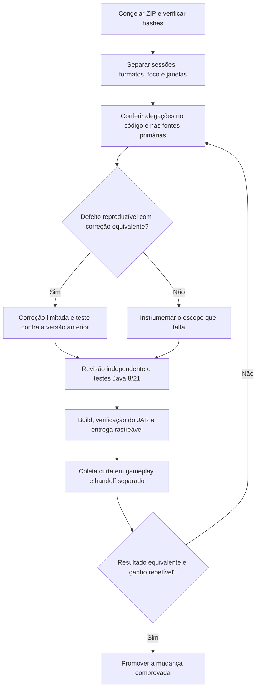

# Decisões de engenharia e próxima validação — 0.1.11

## Resultado da rodada 0.1.10

Houve avanço na evidência de estabilidade dos caminhos corrigidos: não reapareceram as falhas de câmera identificadas anteriormente e os contadores de erro Mirai permaneceram zerados no trecho preservado. A captura não comprova estabilidade universal nem melhora de FPS.

O ZIP contém 602 janelas completas e uma parcial, não apenas seis. A maior parte dos snapshots corresponde a GUI aberta e jogo sem foco. Só dois blocos têm snapshots de gameplay focado nas duas fronteiras: aproximadamente 10 segundos, com FRAME_INTERVAL médio de 55,721 ms (~17,95 FPS nesse recorte). Não há captura GPU preservada da 0.1.10; os comandos ocorreram antes da cobertura JSONL disponível. O arquivo previous-1 mistura log Minecraft e JSONL Mirai; a auditoria separou os formatos, comparou a sobreposição normal e evitou somar ocorrências repetidas. Não atribuímos a mistura ao logger sem prova de sua origem.

Render_Load chega a 227 tarefas e drena. Dez episódios aproximadamente a cada cinco minutos coincidem com recebimento de dados e todos os 1821 commits da cobertura. A origem/conteúdo das atualizações ainda precisa ser investigada; frequência periódica sozinha não comprova redundância. Sync_deferred=0 ocorre com suporte FULL/ready, diferente do NONE/not-ready dos snapshots com deferred positivo na 0.1.9.

No recorte que sustenta a proposta de passe Mirai de 8,9 ms, uploads e tarefas GL são zero. Um controlador de admissão dessas tarefas não eliminaria aquele custo contínuo. Há uploads individuais longos, incluindo um máximo de 100,333 ms, mas um budget entre tarefas não interrompe uma chamada nativa já iniciada.

## Decisões aprovadas

1. Corrigir a espera do trabalhador pela fila GL no fechamento da árvore de LODs, sem liberar seus buffers antes do consumo. Cancelar uma seção durante movimento normal mantém a limitação de produção. Preservar a ordem de limpeza global. Testar regressão contra a 0.1.10, churn normal e integridade de leases/publicação.
2. Medir construção da lista de render e etapas de troca de mundo. A medição deve preservar exceções, contexto, ordem e comportamento quando desativada.
3. Melhorar a coleta: log normal mais todos os arquivos .log presentes na pasta de diagnóstico, com hashes e caminhos preservados. As duas pastas têm arquivos latest.log distintos.
4. Construir a candidata, testar em Java 8/21 e conferir o JAR distribuído. Homologação no modpack permanece uma etapa posterior.

O cancelamento de um CompletableFuture não interrompe por si só a computação que o produz. Por isso o fechamento da árvore libera apenas a espera do trabalhador; os bytes continuam presos à conclusão real do upload. A API usada já existe no Java 8 e suas callbacks síncronas podem executar na thread que conclui o future; o retorno dos checkouts foi conferido para esse contexto. Fonte primária: [contrato de CompletableFuture no Java 8](https://docs.oracle.com/javase/8/docs/api/java/util/concurrent/CompletableFuture.html).

## Propostas não aprovadas nesta entrega

| Proposta | Decisão e evidência necessária |
|---|---|
| Adaptive Frame Governor como P0 para todo o FPS | Adiado. Já existe budget na fila GL; demonstrar custo controlável nas rajadas e definir progresso/memória antes de mudar admissão. Um hard budget não preempta GL/GPU. |
| Atualizar culling distante a cada 2–8 frames usando resultado anterior | Reprovado como equivalente visual: uma seção antes invisível pode aparecer no frame seguinte. Medir primeiro; otimização futura deve usar o frustum atual e preservar overrides. |
| Redução automática de SSAO, AA, fog ou distância | Reprovada para este escopo: altera a qualidade pedida pelo usuário. |
| Reutilizar cache pela aparência/nome/endereço do backend | Reprovado sem identidade autoritativa verificável. Isolamento temporário permanece. |
| Adicionar grace/ramp-up arbitrário no handoff | Adiado. Já existe espera inicial de um segundo. O intervalo entre logs do fallback não mede exclusivamente o Mirai. |
| Remover os bursts de cinco minutos | Adiado até identificar produtor e equivalência do conteúdo. Há tráfego/commits reais. |
| Alterar Angelica, Hodgepodge ou ThePatcher automaticamente | Fora desta candidata. A mensagem MULTI_DRAW_NOT_INDIRECT é do Angelica; repetição de handshake não mede seu custo. São integrações com validação própria. |

## Ordem de trabalho

## Próxima coleta

Use a mesma cena, resolução, distância, efeitos, limite de FPS, dependências e estado de cache ao comparar versões. Registre a versão e o momento de cada ação. Faça gameplay e troca de backend em capturas separadas. Evite permanecer com menu/chat aberto ou jogo sem foco durante a medição principal.

1. Com o mundo carregado, execute `/miraidiag mark cena_parada`, depois `/miraidiag gpu 60`. Feche o chat e mantenha o jogo focado durante a captura. Uma captura parada e outra andando ajudam a separar custo permanente de atualização.
2. Para a troca de backend, use `/miraidiag mark antes_handoff` e `/miraidiag trace 60`, faça a troca, e marque `/miraidiag mark depois_handoff`. Trace tem overhead; não misturar esse recorte com o benchmark principal.
3. Saia normalmente logo após as capturas, preferencialmente em uma sessão de 5–10 minutos, para preservar o início antes de rotação longa. `miraidiag stop` desliga trace/GPU, mas o log básico continua.
4. Rode `scripts/collect-mirai-logs.ps1` com `-GameDirectory` apontando para a pasta do modpack. O arquivo gerado contém `logs/latest.log`, `logs/akashic-mirai/*.log` e manifesto. Não renomeie/concatene manualmente os dois latest.log. Logs normais podem conter dados de servidor/chat; revise o pacote antes de compartilhar publicamente.

Se uma fase lifecycle tem begin sem end, primeiro verificar cobertura e drops; não concluir deadlock automaticamente. `EXPLICIT_GC` mede apenas o retorno da chamada System.gc, não toda pausa de GC posterior nem recursos liberados. Os intervalos de GPU são assíncronos e não representam todo o frame Minecraft.

## Critérios de estabilidade

Sem novos erros Mirai, publicação após fechamento, uso de bytes devolvidos ou mistura de cache; filas devem progredir e drenar sob carga controlada. Ausência de erro em log não certifica imagem: comparar movimento, bordas de LOD, transparência, fog e handoff no jogo. Ganho de FPS exige cenas repetidas e dados de origem/foco comparáveis; não será inferido de uma fila vazia nem de um teste isolado de Java.

Referências: [auditoria quantitativa da 0.1.10](ANALISE-LOGS-0.1.10.md), [mudanças da candidata](CHANGELOG-0.1.11-dev.md). Os pareceres de handoff e governor/culling, fontes primárias fixadas e scripts de reprodução acompanham o ZIP de evidências da entrega.
