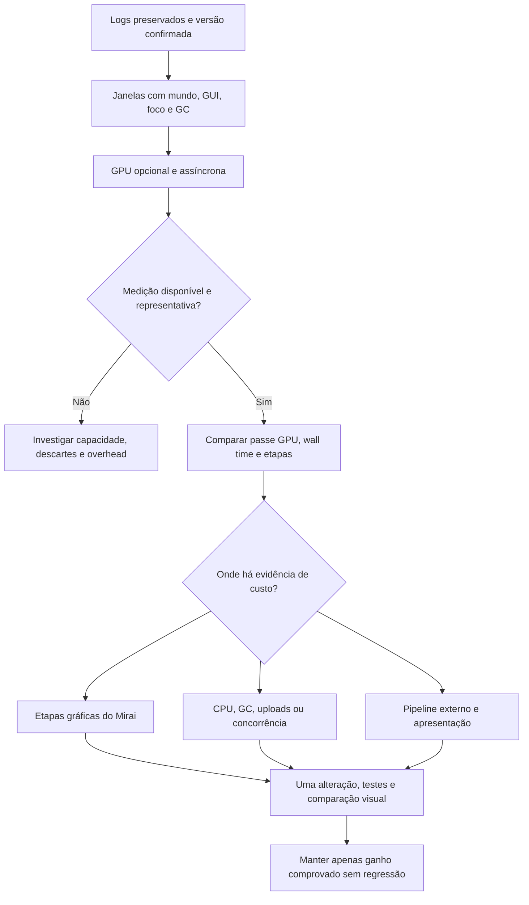

# Rodada 0.1.9: localizar o custo que os tempos atuais não atribuem

## Conclusão sobre a rodada recebida

A execução identifica `0.1.8-dev`, commit `fc3cab1b8939e4f58c359884e3c7d2158c799223`. Os logs são úteis e confirmam baixo FPS durante intervalos com mundo carregado. Ainda não demonstram ganho de FPS em relação à 0.1.7: houve mudanças no CubicChunks, vários carregamentos de mundo e interfaces abertas. Não há vídeo nem comparação controlada da mesma cena.

O diagnóstico próprio completo e o programa que reproduz os cálculos acompanham o pacote de evidências. Os logs originais ficam preservados localmente, fora do pacote distribuído. Os números abaixo vêm dos snapshots de 8 de setembro de 2026, não do relatório superficial fornecido como hipótese.

| Evidência | Interpretação sustentada |
|---|---|
| `latest.log` 2294/2297/2300: intervalo 41,755 ms; LOD 5,313 ms; passe cliente 5,463 ms | A janela citada é real: 120 amostras, aproximadamente 23,95 FPS pelo inverso do intervalo médio. Não é a média da sessão. |
| `latest.log` 2282 e 2310: `gui_open=true` antes/depois | Não classificar como jogo ativo sem interface. Tipo de tela e foco não foram registrados nessa versão. |
| Maior episódio contínuo, retirados 30 s iniciais e 5 s finais: 26 janelas / 131,294 s | Intervalo ponderado 46,781 ms, cerca de 21,38 FPS; LOD 5,432 ms e passe cliente 5,703 ms. Em 24 dessas janelas, a última observação de GUI era verdadeira. Isso contextualiza o relato de ~20 FPS, sem substituir sua medição. |
| Janela 2805: tarefa até 189,309 ms, aumento de 173 ms no contador de GC | Há travamentos ocasionais além do FPS sustentado. A coincidência com GC não prova quanto da tarefa foi execução e quanto foi pausa. |
| Janela 1845: LOD até 368,257 ms e aumento de 244 ms de GC | Timer GPU sozinho não substitui análise de pausas e CPU. |
| Janela 2052: upload até 14,561 ms, sem aumento de GC nessa janela | Uploads também merecem investigação quando ocorrem; não explicam a janela citada sem uploads. |
| `log.txt` 21998–22003, recuperação 22084 | Persiste a falha de cast no painel F3 do CubicChunks dev.5, recuperada pelo CoreTweaks. Não é evidência de que Mirai causou o baixo FPS. |

A ausência do erro de sentinela nesta sessão é favorável; sua correção continua sustentada pelos testes positivos e negativos da 0.1.8, não pela ausência isolada de mensagens. O aviso de ícone de OreQuartz é um candidato de compatibilidade visual separado, sem prova de relação com 20 FPS.

## Julgamento do relatório proposto

Aprovar a instrumentação GPU. Corrigir a interpretação: subtrair 5,463 ms de 41,755 ms produz uma diferença entre médias de escopos, não um bloco causal de 36,292 ms atribuível à GPU. Wall time inclui esperas. CPU e GPU trabalham com sobreposição; seus tempos não devem ser somados como uma sequência simples.

Pares `GL_TIMESTAMP` observam o intervalo entre conclusão de comandos. Ele pode incluir lacunas na submissão pela CPU; não equivale à ocupação exclusiva da GPU. Assim, `DH GPU=25 ms` aumenta a evidência de custo no trecho observado, mas não prova sozinho que shaders estão ocupando a GPU por 25 ms. `DH GPU=5 ms` também não absolve todo o mod: geração, GC, uploads fora do escopo e concorrência continuam possíveis. A [especificação ARB_timer_query da Khronos](https://registry.khronos.org/OpenGL/extensions/ARB/ARB_timer_query.txt) define esses limites, a disponibilidade assíncrona e a convivência de timestamps com queries de tempo decorrido.

A 0.1.9 não mede GPU total de Minecraft, apresentação, VSync, vanilla ou Angelica. Os hooks não cobrem esse pipeline inteiro. Não publicar uma métrica chamada “GPU total do frame” usando apenas o passe Mirai.

## Etapas e critérios de avanço

1. Preservar entradas e verificar versão, ambiente, carregamentos, GUI, exceções e janelas comparáveis.
2. Confrontar as hipóteses com código e APIs primárias; escolher instrumentação que preserve o render.
3. Implementar observação temporária e limitada; testar disponibilidade, saturação, exceções, contexto e encerramento.
4. Compilar o JAR final para 1.7.10/Java 8, repetir suites em Java 8/21 e verificar o artefato distribuído.
5. Coletar baseline e GPU na mesma cena, com foco e interface identificáveis; medir o custo do próprio observador.
6. Somente então priorizar otimização: custo gráfico por etapa, pausas/CPU, apresentação ou trabalho concorrente. Cada mudança precisa preservar a cena e ter comparação antes/depois.

## Implementação desta candidata

GPU desativada por padrão. `/miraidiag gpu 60` solicita até 60 segundos, com limites de 10–120 s. O comando apenas muda estado Java; GL roda no thread/contexto de render. A integração usa o serviço existente LWJGL2/3, com seleção core/ARB e fallback para tempos wall se a capacidade não servir.

São seis slots, com até 22 objetos de query por slot. A cada quarta invocação de cada tipo de passe, registram-se início/fim de PASS e das etapas executadas: fila de tarefas, terreno opaco, objetos com SSAO, SSAO, objetos sem SSAO, transparência, fog, fade distante, AA e composição. As etapas ausentes são omitidas e zero é um resultado válido. Main e deferred têm cadência independente. PASS inclui setup, eventos e restauração; etapas são subconjuntos e não devem ser somadas a PASS.

Consulta-se apenas disponibilidade de pacotes antigos. Não há `glFinish`, espera ativa, leitura imediata do resultado nem alteração de framebuffer, qualidade, shaders, fog, distâncias ou efeitos. Slots ainda ocupados provocam descarte. Falha da instrumentação desativa somente o observador. Contexto diferente nunca recebe exclusão de nomes do contexto anterior; nesse caso, a retenção anterior é limitada e termina com a destruição do contexto original.

Nesta candidata exige-se contador TIMESTAMP com 64 bits, embora a extensão permita contadores menores. É uma limitação conservadora para evitar interpretar wrap ambíguo como duração real. A capacidade efetiva será registrada ao ativar; `ARB_timer_query=true` sozinho não certifica a medição. Queries alheias não são encerradas nem seus resultados consumidos.

`gpu_sample` contém o wall time e os intervalos GPU da mesma amostra. As séries `GPU_MAIN_PASS` e `GPU_DEFERRED_PASS` resumem somente capturas concluídas e disponíveis. `GPU_OBSERVER_WALL` mede chamadas individuais do observador, incluindo coleta/formatação; não é uma média de overhead por frame. A chegada atrasada pode colocar o resultado em outra janela de cinco segundos. CPU/GPU wall não são números aditivos.

Cada evento inclui `capture_start_elapsed_ms`, sequência do passe e `readback_delay_ns`. O atraso é o tempo observado entre fim wall e leitura, não latência exclusiva da GPU. `lod_stage=false` identifica invocações sem etapa de terreno; separar essas amostras ao interpretar médias do desenho LOD. Os snapshots de GUI/foco continuam espaçados em cinco segundos, não rotulam cada frame individualmente.

Rebuilds em workers continuam no domínio de CPU. A etapa TASKS pode incluir uploads executados nessa fila, mas não é “tempo GPU de todos os uploads”; transferências fora dela não são abrangidas. Um governor adaptativo e mudanças de arquitetura Voxy/DH ficam condicionados aos dados: não introduzir ajuste automático de qualidade ou importação de renderer moderno nesta rodada.

## Próxima coleta

1. Instalar somente o JAR final 0.1.9-dev, preservando a configuração usada na 0.1.8. Não manter dois JARs Mirai/DH na pasta mods.
2. No mesmo local, aguardar o carregamento estabilizar. Registrar 30 s sem interface aberta e com a janela em foco. Usar `/miraidiag mark baseline` e fechar o chat após o comando.
3. Usar `/miraidiag gpu 60`, fechar o chat e manter a mesma cena e movimento comparável. O pedido responde imediatamente; o estado efetivo aparece no log. Após a captura, consultar `/miraidiag status` se necessário.
4. Registrar mais 30 s sem captura para comparar o overhead. `/miraidiag gpu stop` encerra só GPU; `/miraidiag stop` encerra GPU e trace, mantendo logging normal.
5. Se for necessário investigar CPU/GC, fazer outra janela com `/miraidiag trace 60`. Evitar misturar duas instrumentações na primeira comparação de overhead.
6. Guardar `logs/latest.log`, `logs/akashic-mirai/latest.log` e eventuais segmentos `previous-*.log` da mesma sessão. Relatar resolução, percurso/cena e FPS observado. O estado de foco e as dimensões da tela agora acompanham o snapshot.

O critério de entrega desta rodada é diagnóstico tecnicamente validado, disponível para teste real. Não há promessa de aumento de FPS pela adição dos timers; medir tem custo e ainda depende do driver da máquina.

Para resumir a captura localmente, usar `python scripts/analyze-mirai-gpu.py latest.log previous-1.log --out gpu-report.json`, apontando para os segmentos da mesma coleta. O analisador separa main/deferred e presença de etapa LOD, remove duplicatas e informa amostras inválidas. Seus percentis são das amostras capturadas, não dos frames do jogo. Sem eventos GPU válidos, retorna indisponível; não inventa tempo zero.
