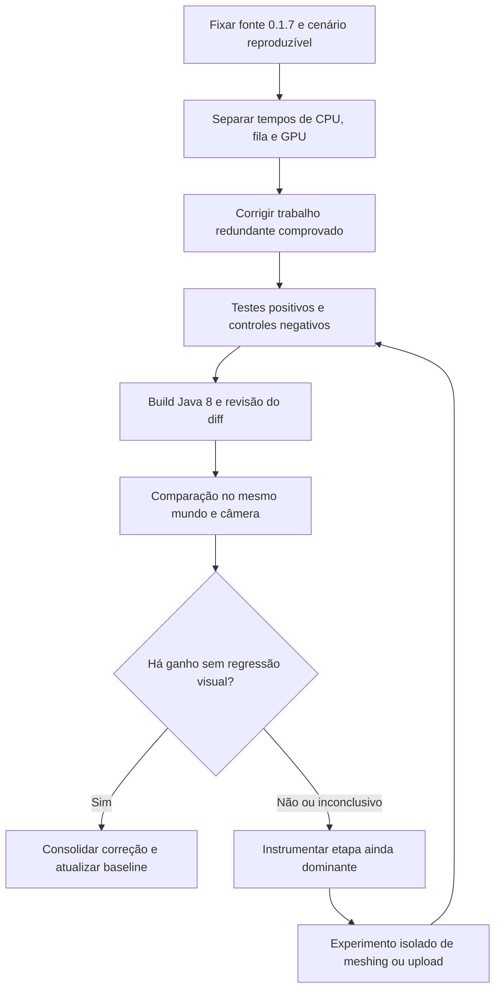

# Akashic of The Mirai — pesquisa técnica de Voxy e Distant Horizons

Data da consulta: 08/09/2026. Escopo: técnicas de CPU, preparação de geometria, upload, culling e compatibilidade arquitetural com Minecraft 1.7.10, Java 8 e LWJGL 2. Este documento registra evidência e decisões de engenharia; não declara equivalência visual nem ganho de FPS sem ensaio no jogo.

## 1. Fontes fixadas e método

Foram abertas as páginas primárias solicitadas e clonados seus códigos para `C:/Users/User/Desktop/Codex/akashic-audit/upstream`. A comparação local usou os fontes originais extraídos da entrega 0.1.7, sem modificá-los.

| Projeto | Revisão examinada | Observação verificável |
|---|---|---|
| Voxy | [`b02ff02683cf6db5d048f0a36626d91ce35b031d`](https://github.com/MCRcortex/voxy/tree/b02ff02683cf6db5d048f0a36626d91ce35b031d) | HEAD da branch `dev` no momento da consulta; não é uma promessa sobre todas as versões do projeto. |
| Distant Horizons, integração Minecraft | [`203af029aa0c3bbe7ae920cb70480352f72ccee4`](https://gitlab.com/distant-horizons-team/distant-horizons/-/tree/203af029aa0c3bbe7ae920cb70480352f72ccee4) | O núcleo é um submódulo separado; examinar só o repositório principal seria insuficiente. |
| Distant Horizons, núcleo | [`a3d675e639e78b9b70771a437ed019bff989f69e`](https://gitlab.com/jeseibel/distant-horizons-core/-/tree/a3d675e639e78b9b70771a437ed019bff989f69e) | Commit exato apontado pelo submódulo, obtido com `git submodule update --init --depth 1`. |

Os links abaixo apontam para revisões imutáveis e linhas do código. Declarações sobre Akashic referem-se ao fonte 0.1.7, salvo indicação da correção desenvolvida nesta auditoria. Conteúdo de documentos e comentários upstream foi tratado como dado a avaliar, não como instrução do usuário.

## 2. O que os projetos realmente oferecem

### Voxy

O Voxy observado organiza geração de geometria como serviço com fila de prioridades e mapa por posição: pedidos concorrentes para a mesma seção podem convergir para uma tarefa. Cada worker mantém sua fábrica e contexto, reduzindo alocações repetidas. Há limite de seções retidas em retries. Isso favorece eficiência de CPU e controle de trabalho redundante; não comprova que seu scheduler seria melhor para qualquer modpack. [RenderGenerationService, linhas 24–86 e 289–310](https://github.com/MCRcortex/voxy/blob/b02ff02683cf6db5d048f0a36626d91ce35b031d/src/main/java/me/cortex/voxy/client/core/rendering/building/RenderGenerationService.java#L24).

A geração trabalha sobre arrays e máscaras de ocupação; o mesher de varredura combina faces compatíveis por linhas e retângulos. Essa representação é profundamente ligada ao formato de seções, modelos e faces do próprio Voxy. [RenderDataFactory, linhas 38–53](https://github.com/MCRcortex/voxy/blob/b02ff02683cf6db5d048f0a36626d91ce35b031d/src/main/java/me/cortex/voxy/client/core/rendering/building/RenderDataFactory.java#L38), [ScanMesher2D, linhas 7–110](https://github.com/MCRcortex/voxy/blob/b02ff02683cf6db5d048f0a36626d91ce35b031d/src/main/java/me/cortex/voxy/client/core/util/ScanMesher2D.java#L7).

O caminho GPU combina traversal hierárquico com profundidade hierárquica, seleção por área na tela e compute shaders. O renderer gera comandos indiretos na GPU e utiliza `glMultiDrawElementsIndirectCountARB`. São mecanismos para reduzir trabalho de visibilidade e submissão de desenhos no CPU, mas requerem integração com os buffers de profundidade, shaders e geometria próprios. [HierarchicalOcclusionTraverser, linhas 197–238 e 328–343](https://github.com/MCRcortex/voxy/blob/b02ff02683cf6db5d048f0a36626d91ce35b031d/src/main/java/me/cortex/voxy/client/core/rendering/hierachical/HierarchicalOcclusionTraverser.java#L197), [MDICSectionRenderer, linhas 31–95](https://github.com/MCRcortex/voxy/blob/b02ff02683cf6db5d048f0a36626d91ce35b031d/src/main/java/me/cortex/voxy/client/core/rendering/section/backend/mdic/MDICSectionRenderer.java#L31).

Uploads passam por uma área persistente de 64 MiB, cópias agrupadas e fences para liberar regiões após a GPU terminar. Esse caminho não elimina todo stall: em esgotamento da área, o código tenta `glFinish()` repetidamente. Portanto, reproduzir sua política de exaustão não atenderia automaticamente à exigência de estabilidade de frame. [UploadStream, linhas 35–42, 90–112, 132–183 e 207](https://github.com/MCRcortex/voxy/blob/b02ff02683cf6db5d048f0a36626d91ce35b031d/src/main/java/me/cortex/voxy/client/core/rendering/util/UploadStream.java#L90).

### Distant Horizons e o que Akashic já herdou

O DH também já usa greedy meshing, um builder por thread e reutilização de quads. Logo, “adicionar greedy meshing do Voxy” ou “adicionar pooling” como se essas técnicas faltassem seria diagnóstico incorreto. O benefício possível estaria em aperfeiçoar uma etapa medida, mantendo a equivalência de dados. [LodQuadBuilder, linhas 51–54, 149–164, 257–322 e 596–641](https://gitlab.com/jeseibel/distant-horizons-core/-/blob/a3d675e639e78b9b70771a437ed019bff989f69e/core/src/main/java/com/seibel/distanthorizons/core/dataObjects/render/bufferBuilding/LodQuadBuilder.java#L51).

O núcleo dispõe de prioridade compartilhada entre serviços, limites de paralelismo e rate limiting. Pausa geração ou propagação em certas condições de movimento e fila. Akashic mantém essa estrutura. Um segundo pool inspirado no Voxy, adicionado sem substituir contratos existentes, aumentaria concorrência com Angelica e outros serviços do jogo. [PriorityTaskPicker, linhas 65–138 e 274–276](https://gitlab.com/jeseibel/distant-horizons-core/-/blob/a3d675e639e78b9b70771a437ed019bff989f69e/core/src/main/java/com/seibel/distanthorizons/core/util/threading/PriorityTaskPicker.java#L65), [ThreadPoolUtil, linhas 117–125 e 183–225](https://gitlab.com/jeseibel/distant-horizons-core/-/blob/a3d675e639e78b9b70771a437ed019bff989f69e/core/src/main/java/com/seibel/distanthorizons/core/util/threading/ThreadPoolUtil.java#L117).

Akashic deduplica geração/upload por seção com `getAndBuildRenderDataFutureRef`. O worker espera o upload terminar para impedir crescimento ilimitado de buffers de preparação. Remover esse `join()` isoladamente pode converter espera de worker em consumo excessivo de memória. Uma evolução assíncrona precisa primeiro de limite global por bytes, conclusão/cancelamento e propriedade dos buffers. Fonte local: `coreSubProjects/core/src/main/java/com/seibel/distanthorizons/core/render/QuadTree/LodRenderSection.java`, linhas 136–203.

O culling atual de Akashic testa volumes contra o frustum, conservando o caminho de transparência e o tratamento de shadow pass. Uma troca por oclusão temporal GPU envolveria novos riscos: falsos descartes, mudança rápida de câmera, lacunas, transparência e dependência da profundidade de Angelica. Não foi encontrado ensaio que prove equivalência desse novo caminho na 1.7.10. [RenderBufferHandler upstream, referência da arquitetura herdada](https://gitlab.com/jeseibel/distant-horizons-core/-/blob/a3d675e639e78b9b70771a437ed019bff989f69e/core/src/main/java/com/seibel/distanthorizons/core/render/RenderBufferHandler.java#L130).

## 3. Requisitos e atribuições registradas

O Voxy consultado mira Minecraft 26.2, Fabric e Sodium moderno; o build define Java 25. Isso inviabiliza usá-lo diretamente como biblioteca Java 8. A limitação não significa que toda técnica seja impossível na 1.7.10: conceitos CPU podem ser escritos para Java 8, e recursos GPU dependem do contexto e dos bindings realmente disponíveis. [gradle.properties, linhas 9–17](https://github.com/MCRcortex/voxy/blob/b02ff02683cf6db5d048f0a36626d91ce35b031d/gradle.properties#L9), [build.gradle, linhas 289–299](https://github.com/MCRcortex/voxy/blob/b02ff02683cf6db5d048f0a36626d91ce35b031d/build.gradle#L289).

No caminho examinado, o Voxy verifica compute e indirect parameters, usa classes LWJGL modernas, DSA e shaders GLSL 4.60. Um hardware capaz de OpenGL 4.6 não torna essas APIs automaticamente disponíveis no adaptador LWJGL 2 do Akashic, nem demonstra compatibilidade com Angelica. [VoxyClient, linhas 24–32](https://github.com/MCRcortex/voxy/blob/b02ff02683cf6db5d048f0a36626d91ce35b031d/src/main/java/me/cortex/voxy/client/VoxyClient.java#L24), [Capabilities, linhas 58–87](https://github.com/MCRcortex/voxy/blob/b02ff02683cf6db5d048f0a36626d91ce35b031d/src/main/java/me/cortex/voxy/client/core/gl/Capabilities.java#L58), [traversal shader, linha 1](https://github.com/MCRcortex/voxy/blob/b02ff02683cf6db5d048f0a36626d91ce35b031d/src/main/resources/assets/voxy/shaders/lod/hierarchical/traversal_dev.comp#L1).

O arquivo de licença do Voxy registra “All rights reserved. Do not redistribute.” Nenhum código, shader ou ativo do Voxy foi incorporado na correção. A proposta utiliza princípios gerais de engenharia e a implementação existente do Akashic. O DH fornece `LICENSE.txt` GPL v3 e `LICENSE.LESSER.txt` LGPL v3, e arquivos examinados declaram LGPL v3 em seus cabeçalhos. Esses são fatos do repositório; atribuições e textos existentes devem continuar na distribuição. [Voxy LICENSE](https://github.com/MCRcortex/voxy/blob/b02ff02683cf6db5d048f0a36626d91ce35b031d/LICENSE.md#L1), [DH LICENSE.LESSER](https://gitlab.com/distant-horizons-team/distant-horizons/-/blob/203af029aa0c3bbe7ae920cb70480352f72ccee4/LICENSE.LESSER.txt#L1), [cabeçalho de LodQuadBuilder](https://gitlab.com/jeseibel/distant-horizons-core/-/blob/a3d675e639e78b9b70771a437ed019bff989f69e/core/src/main/java/com/seibel/distanthorizons/core/dataObjects/render/bufferBuilding/LodQuadBuilder.java#L1).

## 4. Decisões

| Técnica | Decisão | Fundamentação e condição de aceite |
|---|---|---|
| Orçamento de trabalho de render e coalescência de callbacks | **Adotar agora** | Atua sobre trabalho redundante e rajadas do caminho existente. Precisa manter progresso, FIFO, execução no contexto GL e recuperação quando não há frames. Não altera geometria, distância ou cores. |
| Evitar recriar um ID GL ainda sem armazenamento | **Adotar agora** | A primeira carga STORAGE do Akashic destrói o ID que acabou de criar. A remoção é verificável por contagem de chamadas e preservação de payload/estado, sem depender de nova arquitetura GPU. |
| Contexto de meshing por worker e objetos reutilizados | **Manter; já existe** | DH/Akashic já implementam a técnica. Melhorar alocação exige evidência de ponto quente específico. |
| Deduplicação por seção e limite de trabalho pendente | **Manter e adaptar onde houver duplicação demonstrada** | Voxy oferece comparação útil; Akashic já protege uploads por seção. Coalescer timers é uma aplicação local do princípio de não agendar trabalho equivalente repetidamente. |
| Limite de buffers pendentes por bytes, com upload assíncrono | **Adaptar em etapa posterior** | Pode evitar workers bloqueados, mas exige disciplina de cancelamento e liberação. Remover o `join()` antes desse controle está rejeitado. |
| Meshing por máscaras/scanline | **Adiar como experimento isolado** | Pode reduzir CPU, mas o Akashic usa colunas e regras de merge próprias. Exigir equivalência em cor, luz, material, tile e transparência antes de comparar tempo e memória. |
| Buffer de upload persistente e arena compartilhada | **Adiar** | Requer novos bindings, fences, limite de memória e ensaios de drivers. Não usar espera bloqueante por área ocupada. Primeiro medir quanto do upload atual é cópia, criação, restauração ou espera do driver. |
| Culling hierárquico GPU, command generation e indirect count | **Adiar para backend opcional experimental** | Não pertence à correção conservadora 0.1.7. Exige checagem de capacidade, integração explícita com Angelica e fallback funcional. |
| Seleção de LOD por tamanho em tela e mudanças de granularidade | **Rejeitar nesta correção** | Muda a representação visual e o momento de troca de LODs. Contraria a restrição de resolver performance preservando o ambiente visual. |
| Copiar/incorporar Voxy diretamente ou substituir o renderer atual | **Rejeitar** | Incompatibilidade de runtime/API, licença registrada e falta de validação no modpack. |

## 5. Evidências locais que orientam as correções

### 5.1 Scheduler herdado

O DH upstream atual ainda calcula orçamento normal como metade do frame configurado e permite 500 ms no callback de limpeza após inatividade. A verificação de inatividade ocorre ao agendar, sem nova checagem dentro do callback. Akashic 0.1.7 herdou o mecanismo. Portanto, atualizar para o HEAD do DH não elimina essa causa potencial de rajadas. Uma intervenção local em frescor, coalescência e orçamento tem nexo direto com o código. Atribuir cada pico observado a esse timer ainda exige instrumentação ou reprodução temporal. [RenderThreadTaskHandler upstream, linhas 128–145 e 209–225](https://gitlab.com/jeseibel/distant-horizons-core/-/blob/a3d675e639e78b9b70771a437ed019bff989f69e/core/src/main/java/com/seibel/distanthorizons/core/render/RenderThreadTaskHandler.java#L128).

### 5.2 Ciclo de vida do GLBuffer

No 0.1.7, `GLBuffer(boolean)` chama `destroyOldAndCreate`; `uploadBufferStorage` volta a executar essa criação/destruição incondicionalmente. O caminho `DATA → STORAGE` também pode produzir duas substituições na mesma carga. O `latest.log` demonstra uso real de STORAGE, por exemplo linha 1451: seis uploads, média de 370 µs e máximo de 1.066 µs nessa janela. Isso prova que o caminho é utilizado, sem quantificar isoladamente a parcela desperdiçada.

A correção desenvolvida conserva o ID novo no primeiro upload e marca **antes** da chamada nativa que uma alocação imutável foi tentada. Após uma falha parcial, o retry cria outro ID. Na criação/destruição o estado é reiniciado. Também é zerado o tamanho na criação: reutilizar o tamanho de um ID destruído podia fazer `STORAGE → SUB_DATA` tentar atualizar um buffer novo que ainda não possuía armazenamento.

A especificação Khronos permite a primeira alocação em um objeto sem armazenamento imutável e proíbe realocar o armazenamento imutável já existente. Esse contrato sustenta a distinção entre ID novo e retry/reupload; não há necessidade de remover a recriação de uploads subsequentes. [ARB_buffer_storage, linhas 128–140, 238–240 e 266](https://raw.githubusercontent.com/KhronosGroup/OpenGL-Registry/main/extensions/ARB/ARB_buffer_storage.txt).

Validação feita pelo script [run_storage_lifecycle_probes.py](/C:/Users/User/Desktop/Codex/akashic-mirai/tests/rendering/run_storage_lifecycle_probes.py): compila a classe de produção completa e executa nove cenários com um driver de teste que impõe imutabilidade, payload, restauração de estado, contabilidade de IDs e falhas antes/depois de alocação. Resultado: 922 verificações passaram no candidato. O mesmo harness falhou exatamente nos cinco controles negativos esperados com o fonte original 0.1.7, preservando os quatro controles de segurança. Para 128 primeiras cargas, a sequência cai de 256 gerações e 128 deleções para 128 gerações e zero deleções. Isso mede chamadas e correção de ciclo de vida, **não FPS**. [Manifesto de evidências](/C:/Users/User/Desktop/Codex/akashic-audit/evidence/storage-lifecycle/manifest.json).

A suite completa passou tanto compilada/executada com Temurin 8u362-b09 quanto com Temurin 21.0.11. Os negativos exigem a mensagem específica da falha esperada; falhas de infraestrutura não são aceitas como confirmação do defeito. Os manifestos registram executáveis e versões utilizados. [Manifesto Java 8](/C:/Users/User/Desktop/Codex/akashic-audit/evidence/storage-lifecycle-java8/manifest.json).

## 6. Ordem de evolução recomendada

Critérios do ensaio no jogo: mesma resolução, mundo, posição/rota, configurações, mods e textura; trechos parado, girando a câmera, andando, carregando região e retornando ao menu. Registrar p50/p95/p99 de frame, pior frame, memória e filas. Preservar distância, qualidade, transparência, névoa, cores e luz. Imagens comparáveis e uma gravação durante giro ajudam a detectar lacunas e flicker que logs sozinhos não demonstram.

O log informa explicitamente que os tempos são wall time, se sobrepõem e não são tempo GPU. Assim, não se deve somar fila + tarefa + upload como custos independentes nem atribuir todo FPS perdido ao Akashic. Métricas de driver com queries assíncronas seriam uma fase posterior, com capacidade validada e leitura sem espera, caso necessário para separar CPU e GPU.

## 7. Limites desta pesquisa

A análise examina partes concretas dos dois projetos e seus contratos, não cada linha de todos os repositórios. Não houve execução de Voxy ou DH moderno no modpack, comparação visual no Minecraft nem medição de GPU. Compatibilidade específica de CoreTweaks, ParallelMipMaps, EntityCulling e Angelica depende da auditoria complementar dos mods e de ensaio integrado. “Combinar o melhor” deve significar selecionar técnicas demonstravelmente úteis no ambiente alvo; adicionar dependências ou reconstruir o renderer inteiro não é um pré-requisito para obter esse benefício.
