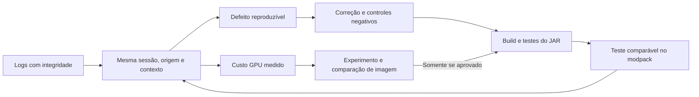

# Akashic: Horizons of The Mirai — auditoria da 0.1.9 e entrega 0.1.10-dev

8 de setembro de 2026. Candidata de desenvolvimento para Minecraft 1.7.10/LWJGL2.

## Veredito sobre a rodada

**Houve avanço comprovado na capacidade de diagnóstico. Ainda não há evidência de que a 0.1.9 tenha resolvido o baixo FPS.** A coleta permite localizar intervalos caros do renderer, associá-los à origem e distinguir parte das transições. Ela também revelou uma exceção real de câmera que o relatório recebido deixou passar.

A 0.1.10-dev entregue aqui corrige essa falha e problemas reproduzíveis de ciclo de vida dos buffers. **Não foi medido ganho de FPS da 0.1.10 no modpack.** As tentativas de otimização GPU foram testadas e rejeitadas quando não mostraram ganho consistente ou exigiram validação adicional da imagem. Não houve redução de qualidade, raio, efeitos ou resolução configurada.

Foram congelados os dois segmentos de diagnóstico e o ZIP do log normal, com SHA-256. Os segmentos são da mesma sessão de 54 min 48 s: 20.932 linhas JSONL e 559 amostras GPU válidas, sem duplicatas ou conflitos. O erro importante estava em `previous-1.log`; analisar somente `latest.log` perderia parte da história.

## Auditoria do relatório recebido

| Afirmação | Resultado da conferência |
|---|---|
| Nenhum erro Mirai; estabilidade certificada | Incorreto. Houve `NullPointerException` em `Camera.update`, no tick do cliente. A janela registra `DH_ERROR_REPORTS=1`. A exceção foi capturada e não matou o Timer. |
| GPU PASS focado próximo de 29,5 ms | Esse valor corresponde às 559 invocações, misturando contextos. Nas 280 amostras LOD com último contexto focado anterior à origem, PASS médio é **28,044 ms** e CPU wall pareado **6,938 ms**. |
| SSAO 10,7 ms e AA 8 ms | Não reproduzido com a mesma seleção. Nas 280 amostras focadas: **SSAO 7,834 ms**, **AA 7,121 ms**. Continuam sendo alvos relevantes. |
| Não somar porque os subestágios se sobrepõem | É preciso conferir os hooks e os membros. Nesta coleta, os dez subestágios observados são sequenciais; com as mesmas 551 linhas LOD, somam 29,892 ms, dentro do PASS 29,914 ms. Misturar PASS de 559 amostras com subestágios de 551 cria uma comparação incorreta. |
| Render_Load máximo 168 contra Builder 1 | Incompleto. Render_Load foi observado em **≥256** em 27 snapshots; é limite inferior do observador. Builder esteve em zero em 456/457 snapshots. Os máximos 168 e 1 citados não pertencem ao mesmo instante. |
| Deferred 1.091 indica dreno problemático | Não demonstrado. O máximo foi **1.111**; todos os 434 snapshots com deferred positivo tinham `support=NONE` e `ready=false`. Isso é compatível com a condição de admissão existente. |
| Stall de 6,1 s causado pelo cache/handoff | A associação temporal com troca de mundo está demonstrada; atribuição causal completa não. O delta de GC daquela janela é zero, mas faltam pilhas e medidas cobrindo todo o intervalo. |

O encerramento normal, os contadores sem falha de banco/upload Java e a ausência de determinados erros são sinais úteis. Eles não certificam toda estabilidade nem ausência de corrupção visual. Também não existe ensaio A/B controlado com a 0.1.8: cena, foco, atividades e versão de CubicChunks diferem.

Os timers GPU medem intervalo de conclusão dos comandos, não ocupação exclusiva do hardware ou o frame inteiro de Minecraft. CPU wall e GPU PASS não podem ser somados para atribuir todo o frame. [Especificação ARB_timer_query](https://registry.khronos.org/OpenGL/extensions/ARB/ARB_timer_query.txt).

## O que mudou na 0.1.10

1. **Câmera durante troca de mundo:** a consulta do tick recusa câmera/mundo ausente ou identidade alterada durante o cálculo. Cada chamada recebe suas próprias coordenadas, evitando o vetor mutável compartilhado. A interpolação e a inversa da matriz da câmera foram preservadas, incluindo terceira pessoa.
2. **Interrupção correta daquele tick:** quando a câmera/jogador não está apto, o level retorna antes de consultar posição para a sincronização. A API `void` anterior foi mantida como delegação. Renderer ausente continua permitindo o fluxo normal de rede.
3. **Memória de geometria e upload:** checkouts de vértices e índices passam a ser devolvidos nos caminhos de erro. A memória permanece reservada até os consumidores terminarem; cancelar o resultado público não permite reutilização enquanto um upload ainda a utiliza.
4. **Trabalho antigo e publicação:** seções fechadas, pedidos substituídos ou níveis desanexados recusam trabalho e resultados tardios. O fechamento do container é idempotente; falha de upload preserva a geometria válida anterior. A publicação usa uma referência volatile e um lock curto, separado do trabalho de banco/geração.
5. **Limpeza após erro de geometria:** o builder local da thread é limpo quando a construção falha, evitando carregar quads incompletos para a seção seguinte. O consumidor de debug também passou a usar uma única referência local de buffer para evitar uma leitura nula durante fechamento.

Esses defeitos foram reproduzidos com falhas e cancelamentos controlados. Os logs não demonstram que vazamentos nesses caminhos eram a causa do FPS estável de aproximadamente 20 relatado. A correção reduz trabalho inválido e torna os caminhos de falha mais seguros; o efeito de desempenho no jogo precisa ser medido.

## Pesquisa de GPU e decisões recusadas

Foram documentadas **15 variantes** de SSAO e AA/CAS em processo OpenGL isolado na Intel UHD, com cenas determinísticas, comparação de canais UNORM16 e medições A/B. Nenhum shader foi promovido a produção.

- Reutilizar pesos espaciais de SSAO preservou os pixels, mas não trouxe ganho consistente.
- Uma saída antecipada de TAA economizou tempo quando a reprojeção saía do histórico; porém alterou arredondamentos em outros pixels em até 1/65535. Isso não prova alteração visível, mas faltou validação temporal acumulada para promovê-la sob o requisito de preservar a imagem.
- A variante TAA que preservou todos os canais testados e a remoção do blend redundante de CAS não demonstraram benefício consistente.
- Não foram reduzidas amostras, resolução, distância, transparência, fog, SSAO ou AA. Não houve importação de código do Voxy.

Reutilização de cache por identidade estável continua dependendo de chaves confiáveis vindas do servidor. O protocolo DH já possui esse mecanismo; o fallback isolado é necessário quando as chaves faltam. Endereço, dimensão ou contador transitório do Patcher não substituem identidade de mundo/geração. Não foram alterados ThePatcher, Angelica, Hodgepodge, configurações ou arquivos do modpack.

## Verificações executadas

| Verificação | Resultado e alcance |
|---|---|
| Build limpo/offline com alvo 1.7.10 | **PASS**, 3 min 55 s; artefato final de `shadeDowngradedApi`, commit identificado. |
| Suítes completas core/API | **282 passaram e 1 foi ignorado por condição de link simbólico no Windows**, em cada JVM: Java 8u362 e 21.0.11. |
| Câmera | **12.023 verificações por JVM**, incluindo 12 mil casos idênticos à matemática da 0.1.9 e 80 mil consultas concorrentes. JOML 1.10.2 e matrizes reais; colaboradores Minecraft controlados. |
| Guard do tick | **7 cenários por JVM**; controle negativo sem a guard reproduz exatamente os dois fluxos indevidos esperados. |
| Buffers e carregamento | **23 cenários por JVM**; 21 controles negativos falham pelos motivos específicos esperados na 0.1.9 e dois controles normais passam. Classes de produção completas, filas/recursos controlados. |
| Testes GPU contra o JAR final | **36 testes passaram em cada JVM**, com origem das classes verificada no artefato distribuído. |
| OpenGL nativo com o JAR final | **42 verificações passaram** em Pbuffer isolado: timer 64 bits, guards de contexto/thread/query buffer, criação e exclusão dos 22 IDs. Sem Minecraft. |
| Bytecode do JAR | **PASS**: resultado inválido da guard retorna antes de consultar posição/rede; delegação void preservada. |
| Compatibilidade do artefato | **PASS** para os gates ABI Angelica 2.2.8/2.1.5, fog color e colisão fastutil. Testes isolados; não é homologação completa desses mods. |
| Continuidade de recursos | **99 recursos conferidos**, sem alterações: shaders, texturas de nuvens, nativos e JSON de mixins selecionados. |

As revisões foram divididas entre análise de logs, implementação do carregamento, pesquisa GPU e coordenação, com inspeção cruzada. Isso é revisão interna de engenharia, não certificação externa. Os guards de câmera também não tornam todos os campos do Minecraft um snapshot atômico.

## Próximo teste recomendado

Para medir render estável, usar a mesma configuração, resolução, posição e direção. Esperar carregar os LODs; executar `/miraidiag mark steady_start` e `/miraidiag gpu 60`, fechar o chat e manter foco. Fazer a captura em movimento separadamente, com outro marcador. Não misturar troca de dimensão à captura estável.

Para investigar os seis segundos, usar `/miraidiag trace 60` e marcador `handoff_start` antes da troca, seguido de `handoff_end` depois. Essa captura procura pilhas e sequência do bloqueio; o custo de trace impede tratá-la como o mesmo benchmark de FPS. Imagens/vídeo ajudam a confirmar o sintoma visual; logs do backend/proxy no mesmo intervalo podem esclarecer a identidade.

Após sair normalmente, guardar **a pasta inteira `logs/akashic-mirai` e o `logs/latest.log` normal da mesma execução**, antes de novos testes. Os arquivos enviados nesta rodada foram boas fontes; a próxima melhoria de evidência é controlar a cena e cobrir o handoff com trace, não simplesmente aumentar a quantidade de logs genéricos.

## Artefato e rastreabilidade

- JAR: `Akashic-Horizons-of-The-Mirai-forge17-0.1.10-dev-1.7.10.jar` — **45.368.860 bytes**.
- SHA-256: `7a5e4a8c7741a3f586cf056637fed11b10ffd39cfe1cc49201cdaeb40a05c87a`.
- Commit: `987f3e7941a471e7b5e0f9c943117fba9ff356d0`.
- Branch local: `akashic/mirai-0.1.10-dev`.
- `Fontes.zip` contém o código desse commit, testes, avisos/licenças e manifesto por arquivo. Não inclui dependências ou histórico Git completo.
- `Evidencias.zip` contém resultados, scripts, pareceres, medições e manifesto. Logs brutos privados do jogador permanecem fora desse pacote.
- `SHA256SUMS.txt` identifica o JAR, os dois ZIPs e este relatório.

Dentro das fontes, os relatórios completos ficam em `docs/ANALISE-LOGS-0.1.9.md`, `docs/PESQUISA-GPU-0.1.10.md` e `docs/PLANO-E-DIAGNOSTICO-0.1.10.md`. Nas evidências, a auditoria lista linhas exatas dos snapshots e todos os membros dos conjuntos GPU; os testes registram suas versões, hashes e limites.

Para instalar a candidata, fechar o Minecraft e substituir o JAR anterior, mantendo uma cópia fora de `mods`. Não instalar junto com outro JAR Distant Horizons/Mirai. A entrega não modificou automaticamente a instalação em uso. O próximo ensaio deve validar aparência, transições e desempenho antes de considerar a candidata homologada.
